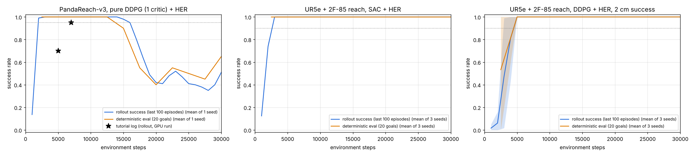
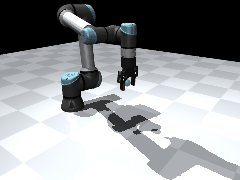
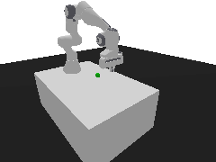
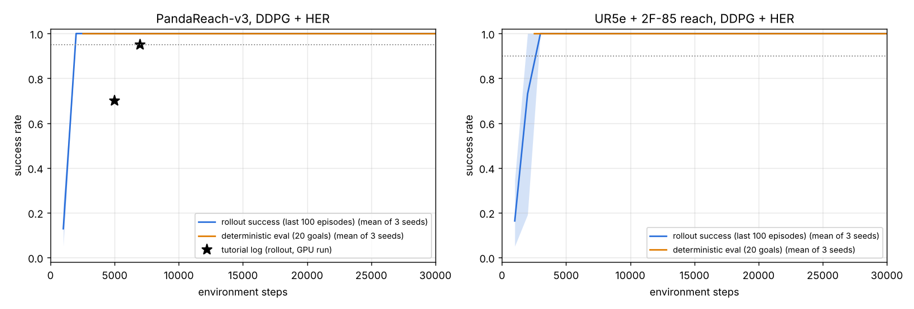

# ur5e-reach-ddpg-her

Basic reach demo for my MTP (RL trajectory planning, IIT Kharagpur), in two phases:

- **Phase A:** replicate a YouTube tutorial, DDPG + HER on panda-gym's `PandaReach`, on today's libraries.
- **Phase B:** the identical DDPG + HER recipe on a **UR5e + Robotiq 2F-85** reach task in MuJoCo
  (`envs/ur5e_reach.py`).

Design notes are in [SPEC.md](SPEC.md).

## Results

| | Steps | Test success | Mean final distance | Wall-clock |
|---|---|---|---|---|
| Panda, original tutorial (GPU) | 1,000,000 | 96-100 % (rollout log, from ~100k steps) | not reported | ~5.8 h (~48 steps/s) |
| **Panda, ours** (3 seeds) | 30,000 | **100 % / 100 % / 100 %** | 3.5 cm | ~2.9 h per seed (1 CPU core, ~2.85 steps/s) |
| **UR5e + 2F-85, ours** (3 seeds) | 30,000 | **100 % / 100 % / 100 %** | 3.7 cm | 2.8 h (seed 0); 4.2-4.3 h (seeds 1-2, on a slower shared VM) |
| Panda, ours, seed 0 continued | 100,000 | **100 %** | 3.6 cm | 8.0 h (1-2 CPU cores) |
| UR5e + 2F-85, ours, seed 0 continued | 100,000 | **100 %** | 4.2 cm | 7.9 h (1-2 CPU cores) |

"Test success" means 100 deterministic episodes on goals never used in training. Both phases pass their acceptance
bars (95 % Panda, 90 % UR5e). Both robots reach 100 % on the 20-goal checks by about 2,000-2,500 steps and stay
there (curves below).

The final distance sits just under 5 cm because an episode ends as soon as the TCP is within 5 cm, so it is not a
precision measure; the 2 cm runs below test precision.

### Extra experiments (30k steps, 100 test episodes each)

| Experiment | Seeds | Test success | Mean final distance | Notes |
|---|---|---|---|---|
| Panda, **pure DDPG** (`n_critics=1`) | 1 | **72 %** | 13.6 cm (worst 134 cm) | 100 % until ~13k steps, then collapsed to 40-50 % |
| UR5e, **SAC + HER**, same settings | 3 | **100 % / 100 % / 100 %** | 3.4 cm | Matches DDPG + HER; no action noise (SAC explores through its entropy term) |
| UR5e, DDPG + HER, **2 cm success threshold** | 3 | **100 % / 100 % / 100 %** | **1.1 cm** (worst 2.0 cm) | Needs ~5k steps instead of ~2.5k |
| UR5e, DDPG + HER, **joint-space actions** | 1 | **100 %** | 4.0 cm | 6 joint increments of up to 0.05 rad (panda-gym's `joints` mode) instead of IK; 90 % at 2.5k steps, 100 % from ~12k |

**Why the tutorial's "DDPG" works and pure DDPG doesn't:** the only difference between the first row and the main
Panda result is the second critic. With one critic, DDPG's Q-values drift upward (overestimation), the actor follows
those errors, and the policy falls apart after reaching 100 %; the worst test episode ends 1.34 m from the goal. The
tutorial's `n_critics=2` adds TD3's clipped double-Q target, which is what keeps training stable here. Only one
seed was run, so this shows the effect rather than measuring it precisely.



Joint-space control (no IK in the loop: the policy moves the 6 joints directly) is the bridge to the full MTP:

| UR5e, joint-space actions |
|---|
|  |

**Plateau check (100k steps):** seed 0 of each robot was continued to 100k steps. Every one of the 39 20-goal
evaluations from 2,500 to 100,000 steps scored 100 % on both robots, and the 100-episode test at 100k is 100 % for
both. Training longer changes nothing on this task. (30k test results for these seeds:
`results/*_s0/test_30k.json`; 100k: `test_100k.json`.)

| Panda (`PandaReach-v3`) | UR5e + 2F-85 (`UR5eReach-v0`) |
|---|---|
|  |  |

Videos play at 1/3 real speed: each reach takes only 2-5 control steps (0.08-0.2 s). MP4s for every run are in [results/videos/](results/videos/). Learning curves (in-training rollout success and 20-goal deterministic evaluations, mean of 3 seeds with min-max band; stars are the tutorial's logged points):



## Run

```bash
python3.11 -m venv .venv && . .venv/bin/activate
pip install torch==2.14.1 --index-url https://download.pytorch.org/whl/cpu
pip install -r requirements.txt
python -m pytest tests                                          # UR5e env checks

python train.py --config configs/panda_ddpg.yaml --seed 0       # resumes from runs/<name>_s<seed>/checkpoint
python evaluate.py --config configs/panda_ddpg.yaml --seed 0    # 100 deterministic test episodes
python record.py --config configs/panda_ddpg.yaml --seed 0      # results/videos/*.mp4 + .gif
python plot.py panda_ddpg ur5e_ddpg                             # results/plots/learning_curves.png
```

Or run the whole pipeline in one go (parallel training, tests, videos, plots, `results/summary.md`):
`python run_all.py --jobs panda_ddpg:0,1,2 ur5e_ddpg:0 --steps 30000 --parallel 4`. Free or cheap GPU and cloud
options (Kaggle, RunPod, Ola Krutrim) are covered in [docs/CLOUD.md](docs/CLOUD.md).

Swap in `configs/ur5e_ddpg.yaml` for Phase B. `train.py --steps N` overrides the config's step budget.
Rendering is headless (MuJoCo via OSMesa: `apt install libosmesa6`; panda-gym via PyBullet's TinyRenderer).
The updated tutorial notebook is [notebooks/panda_reach_ddpg_her.ipynb](notebooks/panda_reach_ddpg_her.ipynb).

## Differences from the tutorial

| Tutorial | This repo | Why |
|---|---|---|
| panda-gym 2.0.0 `PandaReach-v2`, `gym` | panda-gym 3.0.7 `PandaReach-v3`, `gymnasium` 1.4 | 2.0.0 does not install with today's libraries. The API change: `reset()` returns `(obs, info)` and `step()` returns `terminated, truncated`. |
| Episodes always last 50 steps (v2's `step()` returns `done=False`) | Episodes **end on success** (v3) and are truncated at 50 | Part of v3. It also makes the rollout success rate (mean over the last 100 episodes) catch up faster: in the tutorial that window covered ~5,000 steps, which is one reason its logged curve (70 % at 5k, 95 % at 7k) rises later than ours. |
| SB3 1.5, `HerReplayBuffer(online_sampling=True, max_episode_length=...)` | SB3 2.9.2: `online_sampling` and `max_episode_length` dropped | SB3 >= 1.8 always samples HER goals online and reads the episode length from the env. |
| SB3 1.5 DDPG defaults: `train_freq=(1, "episode")`, `gradient_steps=-1` | SB3 2.x defaults: `train_freq=1`, `gradient_steps=1` | Same ratio of one gradient step per environment step; only the timing differs. |
| Python 3.7, GPU, 1e6 steps | Python 3.11, CPU only, 30k steps (seed 0 continued to 100k) | No GPU here. With these settings one CPU core does ~2.9 steps/s (1e6 steps would take ~4 days), and the curve is flat at 100 % from ~2.5k steps. |
| Rollout success only | Plus 100 deterministic test episodes on held-out goals, mean final distance, and 20-goal evaluations every 2.5k steps | Required outputs. |

Unchanged: `TimeFeatureWrapper`, HER `future` with 4 sampled goals, `gamma=0.95`, `batch_size=2048`,
`buffer_size=100_000`, `learning_rate=1e-3`, `net_arch=[512, 512, 512]`, `n_critics=2`, `NormalActionNoise(sigma=0.1)`,
and `learning_starts=100`. The same values are used for the UR5e.

**About `n_critics=2`:** with two critics, SB3's DDPG keeps two Q-networks and uses the minimum of their target
values. That is clipped double-Q learning, one of TD3's three changes to DDPG (TD3 also delays policy updates and
smooths the target policy). The tutorial's "DDPG" is therefore DDPG plus clipped double-Q, not textbook DDPG.
`configs/panda_ddpg_1critic.yaml` runs pure DDPG for comparison.

## UR5e reach environment (Phase B)

Mirrors `PandaReach` as closely as the robots allow:

| | PandaReach-v3 | UR5eReach-v0 |
|---|---|---|
| Robot | Franka Panda (7 joints), PyBullet | UR5e (6 joints) + Robotiq 2F-85 held open, MuJoCo Menagerie models |
| Observation | EE position + velocity (6) | TCP (point between the fingertips) position + velocity (6) |
| Goals | `achieved_goal` EE position, `desired_goal` target | same, with the TCP |
| Action | 3 in [-1, 1] x 5 cm EE displacement -> IK (orientation held) -> joint position control | same: damped least-squares IK with `mj_jacSite` on position + gripper-down orientation, clipped to joint limits, position actuators, 20 physics steps (0.04 s) |
| Goal region | 0.3 m cube | 0.3 m cube centred 0.45 m in front of the base, 0.25 m up |
| Reward / success | sparse -1 / 0, success at 5 cm, terminates on success, 50 steps | same |

UR5e-specific choices, all routine:
- **Ready pose:** TCP at the goal-cube centre, gripper pointing straight down.
- **Gravity compensation** on the arm and gripper bodies, as a real UR controller provides. Without it the
  position servos settle about 1 cm short of the IK target.
- **Arm servo stiffness 5x Menagerie's** (damping and the real 150 / 28 N·m torque limits unchanged). At stock
  gains a full action moves the TCP only 0.9 cm per step, against panda-gym's 2.5-5.8 cm. At 5x it moves
  about 3 cm (about 0.78 m/s, under the UR5e's 1 m/s rated tool speed).
- **Reachability check:** the IK controller driven straight at the goal reaches 500 / 500 sampled goals,
  converging to within 0.1 mm. This is checked in `tests/`.

Tests in `tests/test_env.py` check that:
- IK moves the TCP in the commanded direction;
- the gripper stays pointing down;
- `compute_reward` matches `step()`, including vectorised for HER;
- gymnasium's `check_env` passes;
- 1,000 random steps produce no NaNs;
- 500 goals are reachable.

## Layout

```
configs/            one YAML per run
envs/ur5e_reach.py  Phase B gymnasium env (registered as UR5eReach-v0)
assets/             MuJoCo Menagerie UR5e + Robotiq 2F-85 (BSD licences inside; commit in MENAGERIE_COMMIT)
train.py            --config --seed; checkpoints (model + replay buffer) every 10k steps, CSV logs
run_all.py          parallel jobs -> evaluate -> record -> plot -> results/summary.md
evaluate.py         100 deterministic test episodes -> results/<run>/test.json
record.py           MP4/GIF of the trained policy
plot.py             learning curves
notebooks/          updated tutorial notebook
results/            CSV logs, test results, plots, videos
```
